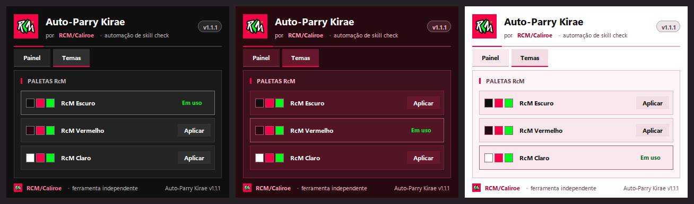

<p align="center">
  
</p>

# Auto-Parry Kirae — por RCM/Caliroe

**Versão 1.1.1** · ferramenta independente para Windows 11 · Python 3.10+ · Tkinter + MSS



O Auto-Parry Kirae é um aplicativo experimental de visão computacional para Windows 11. Ele acompanha a roleta do *skill check* do Kirae no Vesper, estima quando o ponteiro deve atingir o centro da faixa branca do parry **ótimo** e agenda um toque de **Espaço**. A captura usa a região da tela escolhida pelo usuário.

## Como o projeto começou

O projeto começou com uma ideia idiota. Eu só queria parar de perder parries no Vesper. Isso virou um experimento para descobrir quanto dá para prever do movimento da roleta só olhando a tela, com uma interface e um simulador para conferir o resultado.

**RCM/Caliroe** é a minha assinatura. RCM e Caliroe são dois nicks da mesma pessoa.

## Instalação e uso

1. Baixe o ZIP da versão para Windows e extraia a pasta inteira. Mantenha `assets/` ao lado de `auto_parry_kirae.py`. Você também pode clonar o repositório. [Downloads do projeto](https://github.com/Caliroee/auto-parry-kirae/releases)
2. Execute `iniciar_auto_parry.bat`. Ele procura `py`/`python`, instala `mss`, `numpy`, `pillow` e `pynput` **só se faltarem** e abre a interface. Se o Python não existir, abre a página oficial; na instalação marque **Add Python to PATH**.
3. Com a roleta visível no Vesper, clique em **Selecionar área do Skill Check** e contorne o quadro inteiro. O app vincula a janela do Windows sob o centro do recorte.
4. Na primeira vez, ative **Modo teste** para conferir o recorte e a previsão sem enviar Espaço.
5. Com a aba do Vesper aberta na janela vinculada, use **LIGAR/DESLIGAR** ou **F8**. Se você já tiver uma área salva ao abrir o app, pressione **F8** com a janela do Vesper em foco para vincular e ligar. Para usar outra janela, selecione a área novamente.

O vínculo vale durante a sessão. Imediatamente antes de enviar Espaço, o app confere se a janela vinculada está em primeiro plano. O Windows identifica a janela pelo par HWND/PID. Abas diferentes na mesma janela do navegador compartilham esse vínculo.

A compensação inicial é 35 ms. O **auto-ajuste** corrige-a a cada parry com base no ponto em que o ponteiro realmente congelou. A configuração (área, compensação, auto-ajuste) fica em `auto_parry_config.json`, ao lado do programa.

## A interface

| Área | O que mostra |
|---|---|
| **Cabeçalho** | Ícone RcM original, nome, assinatura RCM/Caliroe e versão (v1.1.1) |
| **Temas** | Seleção de paleta entre RcM Escuro, RcM Vermelho e RcM Claro |
| **Controle principal** | Botão grande: **verde = ligado**, **vermelho = desligado**; etiqueta de estado (desligado, aguardando, detectando, mirando, parry enviado) e mensagem do motor |
| **Configuração** | Seleção da área, compensação em ms (slider + botões −/+), auto-ajuste, modo teste |
| **Claim** | Cronômetro manual de 120 min em **Ganhei** ou 60 min em **Perdi**, com aviso ao terminar |
| **Monitoramento** | Prévia da região, contorno vermelho do anel, linha magenta no centro da faixa ótima, estado do motor, FPS de captura, parries registrados, compensação atual e último erro angular e temporal |
| **Rodapé** | Assinatura RCM/Caliroe · ferramenta independente · versão |

A interface ativa o **modo compacto** quando a janela normal passa de 90% da altura da tela. Se o compacto também passar desse limite, o painel ganha rolagem. Sobre o slider, a roda continua ajustando a compensação.

### Temas

Na aba **Temas**, clique em **Aplicar** ao lado de **RcM Escuro**, **RcM Vermelho** ou **RcM Claro**. As três paletas seguem as artes RcM de fundo preto, vermelho e branco. A escolha se aplica na hora e fica em `auto_parry_tema.json`, ao lado do programa, para a próxima abertura. O arquivo `auto_parry_config.json` continua guardando a área, a compensação e o auto-ajuste.

### Cronômetro de claim

Registre o resultado da disputa com **Ganhei** ou **Perdi**. Os dois botões também aceitam **Tab** e **Enter**. Cada registro inicia uma nova contagem. Ao chegar a zero com o app aberto, o painel exibe **Claim disponível** e solicita um aviso sonoro ao sistema. Confira a disponibilidade no jogo, pois o prazo é uma estimativa local a partir do horário em que você registrou o resultado.

O prazo fica em `auto_parry_claim.json`, ao lado do programa. A contagem é retomada ao reabrir o app. Se o prazo já tiver passado, o painel mostra a disponibilidade sem tocar o aviso.

## Identidade visual RcM

- O ícone é usado **exatamente como fornecido** (`assets/rcm_icon.png`, 70×70, sem alteração de desenho ou cores; o hash SHA-256 é o mesmo do arquivo original). As demais versões (`rcm_icon_16…256.png`, `rcm_icon.ico`) são apenas redimensionamentos dele, gerados por `ferramentas/gerar_icones.py`.
- A origem tem 70 px, então as camadas de 128 e 256 px do ICO são ampliações. Preserve o PNG original e use `py ferramentas\gerar_icones.py` para regenerar os derivados.
- As três paletas combinam vermelho, verde, preto e branco da marca. O vermelho e o verde sinalizam o estado do botão principal, o âmbar sinaliza avisos e o magenta identifica a linha de mira.
- O arquivo Python inclui uma cópia idêntica do ícone para carregar a marca se a pasta `assets/` estiver indisponível.
- A assinatura **RCM/Caliroe** aparece na interface, nos inicializadores e neste README.

## Como funciona

1. O **MSS** captura a região escolhida em uma thread própria. O motor recebe os quadros RGB e timestamps de um relógio monotônico.
2. O motor usa **NumPy** para localizar o ponteiro vermelho, estimar o centro e o raio da roleta e identificar a faixa branca seguida da cinza. A posição do ponteiro em quadros sucessivos permite estimar a hora de chegada ao alvo.
3. O agendamento desconta a compensação configurada. Antes do toque de Espaço via **pynput**, o worker verifica se a aplicação está ligada e se a janela do Windows vinculada continua em primeiro plano.
4. O motor observa a posição do ponteiro quando a roleta congela para calcular o erro angular e temporal. Quando há uma leitura válida e o auto-ajuste está ativo, esse erro alimenta a compensação das próximas rodadas.

**Tkinter** e **Pillow** cuidam da interface, da seleção de área e da prévia. O núcleo `Engine` também pode ser chamado pelo simulador com quadros de uma gravação. O **Modo teste** mostra o agendamento previsto com o teclado desativado.

## Arquivos

- `auto_parry_kirae.py` contém a aplicação, a interface e a classe `Engine`.
- `iniciar_auto_parry.bat` abre o app e verifica as dependências.
- `empacotar_exe.bat` gera `dist\AutoParryKirae.exe` com o PyInstaller.
- `assets/` reúne o ícone original, as versões derivadas e o `rcm_icon.ico`. `ferramentas/gerar_icones.py` gera os derivados a partir do original.
- `docs/previa_interface.png` mostra as três paletas da interface.
- `simulador_offline_kirae.py` usa FFmpeg para alimentar o motor com quadros de um vídeo. `resultado_testes_kirae.txt` guarda a saída de referência.
- `tests/` cobre o motor com quadros sintéticos e a lógica de vínculo, F8 e envio com teclado simulado.

## Executável (.exe), opcional

Execute `empacotar_exe.bat` no Windows. O `.exe` usa o ícone `assets\rcm_icon.ico`, guarda a configuração ao lado do arquivo e, se travar ao abrir, grava `auto_parry_erro.log`. Executáveis do PyInstaller sem assinatura digital podem ser sinalizados pelo SmartScreen ou por antivírus, especialmente em programas que enviam teclas.

## Validação e contribuição

Para rodar a suíte local, execute na pasta do projeto com o NumPy instalado.

```powershell
py -B -m unittest discover -s tests -v
```

Ao propor uma alteração, descreva os cenários testados, indique a versão do Windows, Python e Tk e preserve o PNG original e as chaves `region`, `comp` e `auto`. Mudanças no motor precisam de revisão própria com evidência do problema e teste de regressão.

O [relatório de referência](resultado_testes_kirae.txt) registra cinco rodadas detectadas em 1.289 quadros de uma gravação local, sem detecções adicionais fora dessas rodadas. O ensaio rodou offline e sem envio de teclas. A gravação ficou fora do repositório. A suíte sintética cobre, entre outros casos, o fim da faixa cinza após as 12h.

| Validado (como) | Depende do Windows 11 |
|---|---|
| Troca dos três temas no Tk 9.0.4 no Windows 11, persistência após reabrir e rolagem com escala de 200% simulada. A troca conservou região, vínculo, compensação, modo teste e cronômetro. | Mudanças de escala em monitores físicos. |
| Vínculo pelo overlay com uma janela Tk local e Win32 real. Testes com teclado simulado cobrem foco incorreto ou ausente, troca de vínculo após o agendamento e Modo teste. | Atalho global e envio de Espaço em uso real no Vesper. |
| Interface executada com Python 3.15 e Tk 9.0.4. Teste do cronômetro com relógio controlado, gravação e reabertura, chamada única ao aviso e bloqueio de Espaço. | Som audível e comportamento ao suspender a máquina ou voltar com o app minimizado. |
| Janela em DPI 96 real. Escalas de 150%, 175% e 200% simuladas no Tk, com rolagem a 175% e 200%. Modo escuro DWM confirmado via API. | Escalas reais por monitor, posicionamento do overlay em múltiplos monitores e ícone na barra de tarefas. |
| Captura MSS de uma janela local com cor conhecida. Sem área, a interface bloqueou LIGAR. O JSON manteve as três chaves e a atualização conservou a precisão da compensação. | Captura da partida, latência real e impacto da janela no FPS durante uma partida. |
| Arquivos fonte e scripts de empacotamento disponíveis. | Geração e execução do `.exe` com PyInstaller nas versões de Python adotadas. |

## Aviso

Automatizar ações pode violar os termos ou as regras do Vesper ou do jogo Kirae e resultar em restrições à conta. Use por sua conta e risco. A latência da tela, do navegador, da captura, do teclado e do Windows pode deslocar o parry. **Não há garantia de parry perfeito.**

---
<sub>RCM/Caliroe · ferramenta independente · Auto-Parry Kirae v1.1.1</sub>
